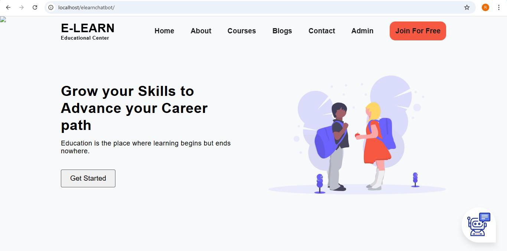

# Varsha GK — Portfolio

Welcome to my portfolio. The website is built with `index.html`, and the `Assets` folder contains project screenshots, supporting files, and other portfolio media.

- **Live portfolio:** [varshagk1.github.io/MY-PORTFOLIO](https://varshagk1.github.io/MY-PORTFOLIO/)
- **GitHub repository:** [github.com/varshagk1/MY-PORTFOLIO](https://github.com/varshagk1/MY-PORTFOLIO)

## Featured Project: Online E-Learning Platform

The portfolio includes screenshots showing the platform’s home page, account registration and sign-in, profile, course catalog, course details, payment, lesson, contact, and admin panel.



## Employee Expense Claim Audit Dashboard

An Excel project for reviewing employee expense claims, checking policy limits and receipts, identifying duplicate claims and risk levels, and summarizing results in a dashboard.

Supporting files in `Assets`:

- `EMPLOYEE EXPENSE CLAIM AUDIT DASHBOARD.xlsx`
- `audi.xlsx`
- `policy.xlsx`

## Portfolio Media and Documents

- `about-varsha-expense-audit.mp4` — video used in the portfolio’s About section
- `resume.pdf` — resume document
- `01-home.png` through `08-lesson.png`, plus `10-contact.png` and `11-admin-panel.png` — project screenshots

## Repository Structure

```text
MY-PORTFOLIO/
├── index.html
├── README.md
└── Assets/
    ├── project screenshots,PowerBI,Python,HTML,CSS,JAVASCRIPT,DIJANGO,OPENCV,PHP,MYSQL Projects
    ├── Excel workbooks
    ├── about-varsha-expense-audit.mp4
    └── resume.pdf
